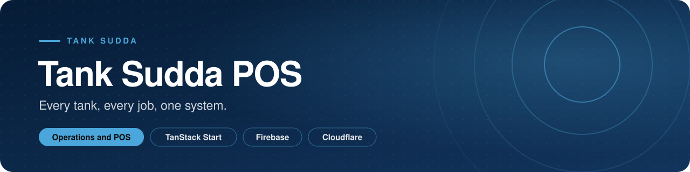
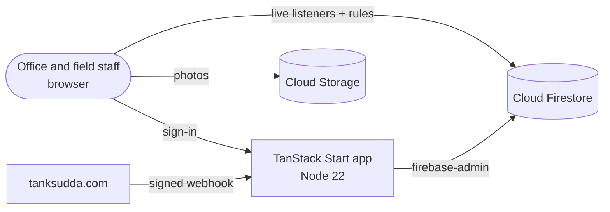
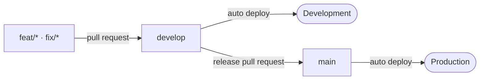

<a id="readme-top"></a>

<div align="center">



<br/>

<p><strong>Leads, inspections, scheduling, jobs, quotes, invoices, payments, staff and reporting for water tank and sump cleaning, live on every device.</strong></p>

<a href="https://github.com/saadmaz/Tank-Sudda-POS/releases"></a>
<a href="https://github.com/saadmaz/Tank-Sudda-POS/actions/workflows/ci.yml"></a>
<a href="https://github.com/saadmaz/Tank-Sudda-POS/deployments"></a>
<a href="https://github.com/saadmaz/Tank-Sudda-POS/commits/develop"></a>


<br/>

<a href="https://os.tanksudda.com"></a>
<a href="docs/README.md"></a>
<a href="https://github.com/saadmaz/Tank-Sudda-POS/issues/new?template=bug_report.yml"></a>
<a href="https://github.com/saadmaz/Tank-Sudda-POS/issues/new?template=feature_request.yml"></a>

<br/>

<a href="#about">About</a> ·
<a href="#features">Features</a> ·
<a href="#architecture">Architecture</a> ·
<a href="#getting-started">Getting started</a> ·
<a href="#deployment">Deployment</a> ·
<a href="#documentation">Documentation</a> ·
<a href="#contributing">Contributing</a>

</div>

---

<details>
<summary><strong>Table of contents</strong></summary>

1. [About](#about)
2. [Features](#features)
3. [Architecture](#architecture)
4. [Tech stack](#tech-stack)
5. [Getting started](#getting-started)
6. [Configuration](#configuration)
7. [Project structure](#project-structure)
8. [Quality checks](#quality-checks)
9. [Deployment](#deployment)
10. [Documentation](#documentation)
11. [Releases and versioning](#releases-and-versioning)
12. [Contributing](#contributing)
13. [Security](#security)
14. [License](#license)

</details>

## About

Tank Sudda POS runs the day-to-day operation of Tank Sudda, a water tank and sump cleaning service in Sri Lanka. The office takes leads and books inspections, supervisors schedule crews and equipment, technicians work through jobs on their phones, and the office raises quotes and invoices, records payments and settles each job. The website at [tanksudda.com](https://tanksudda.com) feeds bookings straight in as leads.

It replaces the legacy single-file operations app ([ADR-0001](docs/adr/0001-rebuild-the-legacy-single-file-app.md)) and is delivered in phases; see the [roadmap](docs/FEATURES.md#delivery-roadmap).

| At a glance      |                                                 |
| ---------------- | ----------------------------------------------- |
| **Organisation** | Tank Sudda (Pvt) Ltd                            |
| **Status**       | Ready for launch                                |
| **Production**   | [os.tanksudda.com](https://os.tanksudda.com)    |
| **Contact**      | [info@tanksudda.com](mailto:info@tanksudda.com) |
| **Maintainer**   | [Saad Mazhar](https://github.com/saadmaz)       |

<p align="right"><a href="#readme-top">Back to top ↑</a></p>

## Features

<table>
<tr><td width="50%" valign="top"><strong>Sign-in and access</strong><br/>Individual staff accounts with a 4-digit PIN, lockout after failed attempts, roles and per-module permissions enforced by Firestore rules</td><td width="50%" valign="top"><strong>Dashboard</strong><br/>Revenue against target, cash and bank splits, and lead, inspection, scheduled, completed and cancelled counts for any date range</td></tr>
<tr><td width="50%" valign="top"><strong>Leads and jobs</strong><br/>Intake with customer autofill, overhead tanks by size, sumps by dimensions, transport, ladder and custom add-ons, discounts and a live total</td><td width="50%" valign="top"><strong>Inspections</strong><br/>Tank, sump and cleaning checklists, observations and a printable inspection report, converted to a job in one step</td></tr>
<tr><td width="50%" valign="top"><strong>Schedule</strong><br/>Calendar of inspections and multi-day jobs with supervisor, technician and equipment assignment</td><td width="50%" valign="top"><strong>Quotes, invoices and payments</strong><br/>Branded PDFs with editable line items, terms and bank details, instalment payments and paid or unpaid status</td></tr>
<tr><td width="50%" valign="top"><strong>Settlement</strong><br/>Close a job with its expense breakdown, net profit and a job settlement report</td><td width="50%" valign="top"><strong>Customers</strong><br/>Customer profiles with every site, tank and past job, and re-clean reminders when the next cleaning is due</td></tr>
<tr><td width="50%" valign="top"><strong>Reports and analytics</strong><br/>Daily operations ledger, daily reconciliation, trends by service, location and source, and CSV export</td><td width="50%" valign="top"><strong>Field tools</strong><br/>Before and after photos, WhatsApp message templates and offline use with sync on reconnect</td></tr>
<tr><td width="50%" valign="top"><strong>Website intake</strong><br/>Bookings and enquiries from tanksudda.com arrive as leads through a signed webhook</td><td width="50%" valign="top"><strong>Settings and audit</strong><br/>Prices, locations, staff, equipment, terms, bank details and targets, with an audit log of every change</td></tr>
</table>

<p align="right"><a href="#readme-top">Back to top ↑</a></p>

## Architecture

A TanStack Start application on Node.js 22, running in a Cloudflare Container behind a Worker, with Cloud Firestore as the single source of truth. Screens are live listeners, staff sign in with a PIN checked on the server, and Firestore rules enforce roles and per-module permissions at the data layer. A signed webhook accepts leads from the website.



> [!TIP]
> The full design is in [docs/ARCHITECTURE.md](docs/ARCHITECTURE.md). Significant decisions are recorded as [architecture decision records](docs/adr/README.md).

<p align="right"><a href="#readme-top">Back to top ↑</a></p>

## Tech stack

<p>


</p>

<details>
<summary><strong>Full stack breakdown</strong></summary>

| Layer         | Technology                                                                                 |
| ------------- | ------------------------------------------------------------------------------------------ |
| Framework     | [TanStack Start](https://tanstack.com/start) (React 19, file-based routing, server routes) |
| Language      | TypeScript                                                                                 |
| Styling       | Tailwind CSS v4 and Radix-based UI primitives                                              |
| Data and auth | Firebase (Cloud Firestore, Authentication, Storage) and `firebase-admin` on the server     |
| Documents     | jsPDF                                                                                      |
| Build         | Vite                                                                                       |
| Hosting       | Cloudflare Worker + Container (Node 22), deployed by GitHub Actions with Wrangler          |
| Tooling       | npm, Vitest, Firebase Emulator Suite, ESLint, Prettier                                     |

</details>

<p align="right"><a href="#readme-top">Back to top ↑</a></p>

## Getting started

### Prerequisites

- Node.js 22 (see [`.nvmrc`](.nvmrc))
- npm 10 or later
- [Firebase CLI](https://firebase.google.com/docs/cli) and Java 17 or later for the emulators

### Install and run

```sh
git clone https://github.com/saadmaz/Tank-Sudda-POS.git
cd Tank-Sudda-POS
npm ci
cp .env.example .env    # fill in the Firebase web config and server credentials
npm run dev
```

Vite prints the local address when the server starts. Point `VITE_FIREBASE_*` at a development Firebase project, never production.

<details>
<summary><strong>All scripts</strong></summary>

| Command                                   | Description                                                                       |
| ----------------------------------------- | --------------------------------------------------------------------------------- |
| `npm run dev`                             | Start the development server                                                      |
| `npm run build`                           | Production build: client, server bundle and build id                              |
| `npm start`                               | Run the production server (`server.mjs`) on port 8080                             |
| `npm run deploy`                          | Build and deploy to Cloudflare from your machine                                  |
| `npm run lint`                            | Lint with ESLint (includes Prettier rules)                                        |
| `npm run typecheck`                       | Type-check with `tsc`                                                             |
| `npm run format` / `format:check`         | Format with Prettier, or check without writing                                    |
| `npm test`                                | Unit tests (Vitest)                                                               |
| `npm run test:rules`                      | Firestore rules tests (starts the emulator)                                       |
| `npm run seed:admin`                      | Create the first SuperAdmin from `.env`                                           |
| `npm run deploy:rules`                    | Deploy Firestore and Storage rules                                                |
| `npm run legacy:export` / `legacy:import` | Move data from the legacy app (see the [runbook](docs/runbooks/legacy-import.md)) |

</details>

<p align="right"><a href="#readme-top">Back to top ↑</a></p>

## Configuration

The Firebase web config and the server's service account are set in `.env`. Business settings such as prices, locations, staff and terms are managed in the app under **Settings**.

<details>
<summary><strong>Environment variables</strong></summary>

| Variable                                                               | Purpose                                                               |
| ---------------------------------------------------------------------- | --------------------------------------------------------------------- |
| `VITE_FIREBASE_*`                                                      | Firebase web app config (public identifiers compiled into the client) |
| `FIREBASE_PROJECT_ID`, `FIREBASE_CLIENT_EMAIL`, `FIREBASE_PRIVATE_KEY` | Service account for `firebase-admin` on the server. **Secret**        |
| `SUPERADMIN_*`                                                         | First SuperAdmin, used once by `seed:admin`. **Secret**               |
| `VITE_SENTRY_DSN`                                                      | Optional error reporting                                              |

Where each value is set, and which are secret: [docs/CONFIGURATION.md](docs/CONFIGURATION.md).

</details>

<p align="right"><a href="#readme-top">Back to top ↑</a></p>

## Project structure

<details>
<summary><strong>Repository layout</strong></summary>

```
.
├── .github/workflows/       # CI and deployment
├── docs/                    # Architecture, configuration, deployment, features, ADRs, runbooks
├── public/                  # Static assets and brand marks
├── scripts/                 # Build helpers, seeding, rules deploy and rules tests
├── src/
│   ├── components/          # Feature components and Radix-based UI primitives
│   ├── hooks/               # Shared hooks
│   ├── lib/                 # Domain logic (pricing, money, dates, permissions) and tests
│   ├── routes/              # File-based routes: staff app (_app.*), health check, public API
│   ├── server/              # Server-only modules
│   └── styles.css           # Design tokens and global styles
├── firestore.rules          # Data-layer security rules
├── storage.rules            # Storage security rules
├── worker/                  # Cloudflare Worker that fronts the container
├── Dockerfile               # Production container image
├── server.mjs               # Production Node server
├── wrangler.jsonc           # Cloudflare configuration
└── vite.config.ts           # Build configuration
```

</details>

<p align="right"><a href="#readme-top">Back to top ↑</a></p>

## Quality checks

Every pull request into `develop` or `main` runs the [CI workflow](.github/workflows/ci.yml): lint, formatting, type check, unit tests and a production build. Pull requests merge only when CI is green.

```sh
npm run lint && npm run format:check && npm run typecheck && npm test && npm run build
```

> [!IMPORTANT]
> Run the same checks locally before opening a pull request. They are the exact commands CI runs.

<p align="right"><a href="#readme-top">Back to top ↑</a></p>

## Deployment

| Environment | Branch    | URL                                                  | Status                                                                                                                                                         |
| ----------- | --------- | ---------------------------------------------------- | -------------------------------------------------------------------------------------------------------------------------------------------------------------- |
| Development | `develop` | [dev.os.tanksudda.com](https://dev.os.tanksudda.com) |  |
| Production  | `main`    | [os.tanksudda.com](https://os.tanksudda.com)         |   |



> [!IMPORTANT]
> The app is set up for Cloudflare: a Worker in front of a Cloudflare Container. Deploys switch on with the `CLOUDFLARE_ENABLED` and `DEVELOPMENT_ENABLED` variables.

Setup, environments, secrets and post-deployment checks are in [docs/DEPLOYMENT.md](docs/DEPLOYMENT.md).

> [!TIP]
> To ship or undo a release, follow the [release](docs/runbooks/release.md) and [rollback](docs/runbooks/rollback.md) runbooks.

<p align="right"><a href="#readme-top">Back to top ↑</a></p>

## Documentation

Every STTPS repository uses the same documentation layout.

| Document                               | Covers                                               |
| -------------------------------------- | ---------------------------------------------------- |
| [Documentation index](docs/README.md)  | Every document in this repository                    |
| [Architecture](docs/ARCHITECTURE.md)   | How the system is built and how data flows           |
| [Configuration](docs/CONFIGURATION.md) | Environment variables and configuration files        |
| [Deployment](docs/DEPLOYMENT.md)       | Environments, hosting, pipeline and first-time setup |
| [Features](docs/FEATURES.md)           | Every module and the phased delivery roadmap         |
| [Decision records](docs/adr/README.md) | Why the system is built the way it is                |
| [Runbooks](docs/runbooks/README.md)    | Release and rollback procedures                      |

<p align="right"><a href="#readme-top">Back to top ↑</a></p>

## Releases and versioning

[](https://github.com/saadmaz/Tank-Sudda-POS/releases)

The project follows [Semantic Versioning](https://semver.org). Every release is tagged `vX.Y.Z`, published on the [Releases](https://github.com/saadmaz/Tank-Sudda-POS/releases) page with its notes, and recorded in [CHANGELOG.md](CHANGELOG.md). The procedure is in [docs/runbooks/release.md](docs/runbooks/release.md).

<p align="right"><a href="#readme-top">Back to top ↑</a></p>

## Contributing

| Step |                                                                           |
| ---- | ------------------------------------------------------------------------- |
| 1    | Branch from `develop` using a type prefix (`feat/`, `fix/`, `docs/`, ...) |
| 2    | Commit with [Conventional Commits](https://www.conventionalcommits.org)   |
| 3    | Open a pull request into `develop` and complete the checklist             |
| 4    | Squash and merge once CI is green and the change is reviewed              |

The full guide is in [CONTRIBUTING.md](CONTRIBUTING.md). Everyone taking part follows the [Code of Conduct](CODE_OF_CONDUCT.md).

<p align="right"><a href="#readme-top">Back to top ↑</a></p>

## Security

> [!IMPORTANT]
> Never report a vulnerability in a public issue. Follow [SECURITY.md](SECURITY.md) to report it privately; you will hear back within three business days.

<p align="right"><a href="#readme-top">Back to top ↑</a></p>

## License

Copyright © 2026 Tank Sudda (Pvt) Ltd. All rights reserved.

This is proprietary software. The source is publicly visible, but no permission is granted to use, copy, modify or distribute it without prior written consent. See [LICENSE](LICENSE.md).

<div align="center">
<br/>
<sub>Built and maintained by the Tank Sudda team · Part of the <a href="https://sttps.co">STTPS group</a></sub>
</div>
