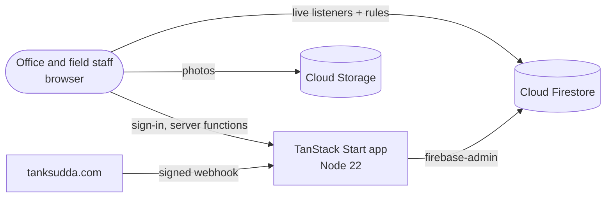
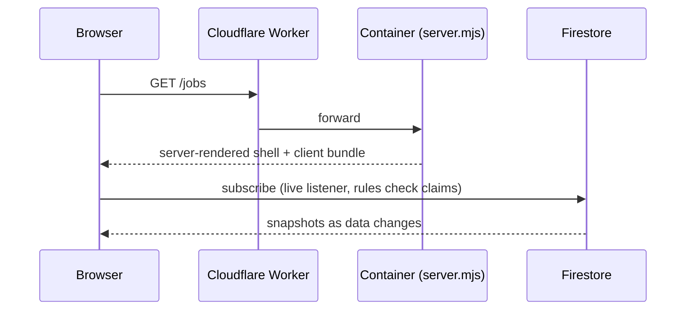
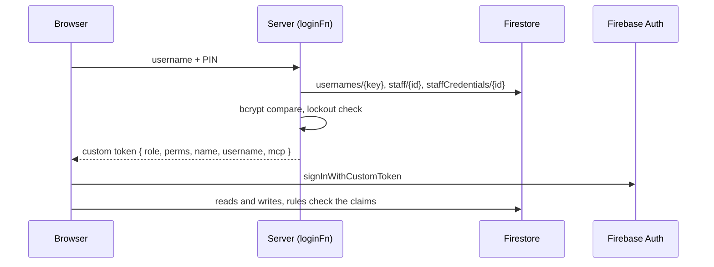

# Architecture

<!-- nav -->

<a href="../README.md">Project README</a> · <a href="README.md">Documentation index</a>

> How Tank Sudda OS is built and how data moves through it. Part of the [project documentation](README.md).

## Overview

A TanStack Start application on Node.js 22, running in a Cloudflare Container behind a Worker. Cloud Firestore is the single source of truth ([ADR-0002](adr/0002-firestore-as-the-single-source-of-truth.md)): screens read through live listeners and write through Firestore security rules. The server handles what the browser must never do itself: PIN verification and token minting ([ADR-0003](adr/0003-staff-sign-in-with-a-pin-and-custom-tokens.md)), the website intake API and scheduled jobs.

## Components

| Component       | Where                   | Responsibility                                                                  |
| --------------- | ----------------------- | ------------------------------------------------------------------------------- |
| Routes          | `src/routes/`           | File-based routes: staff app screens (`_app.*`), health check and public API    |
| Domain logic    | `src/lib/`              | Pricing, money, dates, statuses and permissions as pure, unit-tested TypeScript |
| UI primitives   | `src/components/ui/`    | Radix-based building blocks styled with the design tokens in `src/styles.css`   |
| Server modules  | `src/server/`           | Server-only code: `firebase-admin`, sign-in, intake handlers                    |
| Production host | `server.mjs`, `worker/` | Node server with security headers, fronted by a Cloudflare Worker               |

## Request flow

## Sign-in

| Collection              | Holds                                                         | Client access                     |
| ----------------------- | ------------------------------------------------------------- | --------------------------------- |
| `staff/{id}`            | Directory: name, phone, field roles, active, sign-in and role | Read when signed in               |
| `staffCredentials/{id}` | PIN hash, failed attempts, lockout, forced PIN change         | None                              |
| `usernames/{key}`       | Username index for sign-in                                    | None                              |
| `auditLog/{id}`         | Append-only record of changes                                 | Manager+ read; append in own name |

### Business data

| Collection           | Holds                                                                               | Written by                             |
| -------------------- | ----------------------------------------------------------------------------------- | -------------------------------------- |
| `settings/general`   | Prices, locations, equipment, terms, targets, document numbering                    | Settings (Manager+)                    |
| `customers/{id}`     | Profile, phones (with a canonical `phoneKey`), sites, last and next cleaning        | Job editor, customer page              |
| `inspections/{ref}`  | Site checklist and measurements, linked to a job; `IN-YYMMDD-XXXX`                  | Inspections (field and office)         |
| `payments/{id}`      | Money received against a job; voided, never deleted                                 | Job page, settlement, billing          |
| `counters/documents` | Next quote and invoice numbers, only ever increasing                                | Quote and invoice buttons              |
| `jobs/{ref}`         | One piece of work from lead to completion; the id is the reference `TS-YYMMDD-XXXX` | Leads, jobs, field crews (status only) |

Leads and jobs share the `jobs` collection ([ADR-0005](adr/0005-leads-and-jobs-share-one-collection.md)). Each job stores its own prices and a computed `subtotal` and `total`, so reports never re-price old work. Every write goes through `src/lib/db.ts`, which batches the job with its customer and appends an audit entry.

### Keeping reads low

The app listens to every open job plus closed jobs updated in the last 120 days, rather than the whole history. A customer's page and a single job page subscribe to exactly what they show, so older records still open instantly. Both listeners use single-field queries, which need no composite indexes.

Changing someone's role, modules or active status revokes their refresh tokens, so the old claims stop working within an hour at most.

## Design principles

- **Pure domain logic.** Anything that calculates money, prices or dates lives in `src/lib` with unit tests and no Firebase or React imports.
- **Rules are the security boundary.** UI checks are for convenience; Firestore rules enforce every permission.
- **Typed collections.** Each entity has its own collection and a typed shape; free-text fields are never parsed back into data.
- **Mobile first.** Field staff work on phones, so every screen works at phone width with touch-sized controls.
