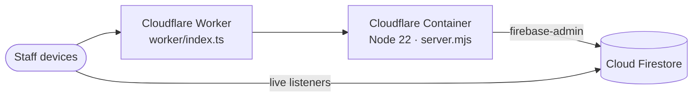

# Deployment

<!-- nav -->

<sub><a href="../README.md">Project README</a> · <a href="README.md">Documentation index</a></sub>

> How Tank Sudda POS reaches production. Part of the [project documentation](README.md).

> [!IMPORTANT]
> The app runs on **Cloudflare**: a Worker in front of the Node server in a Cloudflare Container ([ADR-0004](adr/0004-host-on-cloudflare.md)). Deploys switch on with the `CLOUDFLARE_ENABLED` (production) and `DEVELOPMENT_ENABLED` (development) repository variables. Until they are set, merges build and test in CI but deploy nowhere.

## Environments

| Environment   | Branch    | URL                                                  | Cloudflare Worker           |
| ------------- | --------- | ---------------------------------------------------- | --------------------------- |
| `development` | `develop` | [dev.os.tanksudda.com](https://dev.os.tanksudda.com) | `tank-sudda-os-development` |
| `production`  | `main`    | [os.tanksudda.com](https://os.tanksudda.com)         | `tank-sudda-os`             |

Each is a GitHub Environment with its own variables (`APP_URL`) and secrets. Production accepts deployments from `main` only; development from `develop` only.

### Promotion

1. Feature branches merge into `develop` and deploy to development (once `DEVELOPMENT_ENABLED` is `true`).
2. A release pull request from `develop` into `main` (see [runbooks/release.md](runbooks/release.md)) promotes the change.
3. Merging it deploys to production (once `CLOUDFLARE_ENABLED` is `true`).

## How it runs



| File                                    | Role                                                                                                   |
| --------------------------------------- | ------------------------------------------------------------------------------------------------------ |
| [`server.mjs`](../server.mjs)           | Node server: serves `dist/client`, passes other requests to the app, sets the CSP and security headers |
| [`Dockerfile`](../Dockerfile)           | Production image: production dependencies, the build output and `server.mjs`, run as a non-root user   |
| [`worker/index.ts`](../worker/index.ts) | Worker that forwards requests to one shared container instance and passes runtime secrets to it        |
| [`wrangler.jsonc`](../wrangler.jsonc)   | Worker, container and Durable Object configuration for production and development                      |

## How a deploy works

[`deploy.yml`](../.github/workflows/deploy.yml) runs on every push to `main` or `develop`:

1. Install dependencies and run `npm run build` with the environment's Firebase web config.
2. Deploy with Wrangler, which builds the container image from the `Dockerfile`, publishes the Worker and uploads the runtime secrets.
3. Smoke-test `/healthz`, which must return `ok`.

## First-time setup

1. **Cloudflare API token.** Create a token with the _Edit Cloudflare Workers_ template plus _Containers: Edit_, and store it as the `CLOUDFLARE_API_TOKEN` secret. Set `CLOUDFLARE_ACCOUNT_ID` as a repository variable.
2. **Environments.** Create the `production` and `development` GitHub Environments, each with an `APP_URL` variable and the secrets listed in [CONFIGURATION.md](CONFIGURATION.md).
3. **Switch on deploys.** Set `CLOUDFLARE_ENABLED` to `true`, then run the **Deploy** workflow on `main`.
4. **Domain.** In the Worker's settings, add `os.tanksudda.com` as a custom domain.
5. Repeat steps 2 to 4 for development with `dev.os.tanksudda.com`, then set `DEVELOPMENT_ENABLED` to `true`.

## Firebase setup

1. Create (or choose) the Firebase project and enable Firestore, Authentication and Storage. Custom-token sign-in needs no provider to be switched on.
2. Add a web app and copy its config into the `VITE_FIREBASE_*` secrets; generate a service account key for the `FIREBASE_*` secrets and `FIREBASE_SERVICE_ACCOUNT_JSON`.
3. Set the `FIREBASE_RULES_ENABLED` repository variable to `true`. [`firebase-deploy.yml`](../.github/workflows/firebase-deploy.yml) then deploys `firestore.rules` and `storage.rules` whenever they change on `main`, or on demand.
4. From a machine with the service account in `.env`, create the first SuperAdmin once:

   ```sh
   npm run seed:admin
   ```

5. Sign in, choose a new PIN, and add everyone else under **Staff**.

## Run the production build locally

```sh
npm run build
npm start                  # node server.mjs on http://localhost:8080
docker build -t tank-sudda-os . && docker run -p 8080:8080 --env-file .env tank-sudda-os
```

## Backups

- **Code:** GitHub is the source of truth; every release is tagged.
- **Firestore:** enable scheduled backups in Firebase Console → Firestore → Backups with a daily schedule and 7 to 14 days' retention.
- **Secrets:** keep a copy of the production values in the team password manager.

## Post-deployment checks

1. `/healthz` returns `ok`.
2. A staff member can sign in with their PIN at [os.tanksudda.com](https://os.tanksudda.com).
3. Response headers include the Content Security Policy and `Strict-Transport-Security`.
