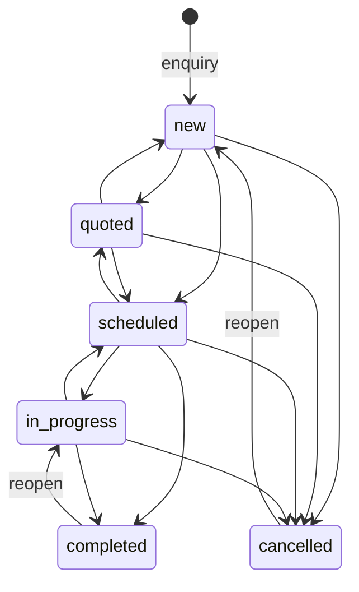

# Features

<!-- nav -->

<a href="../README.md">Project README</a> · <a href="README.md">Documentation index</a>

> Every module in Tank Sudda POS, who uses it, and the order in which it is delivered.

## Delivery roadmap

The system replaces the legacy single-file operations app (see [ADR-0001](adr/0001-rebuild-the-legacy-single-file-app.md)) and ships in phases. Each phase is one or more pull requests into `develop`, released to `main` as a minor version.

| Phase | Release | Scope                                                                                                    | Status    |
| :---: | :-----: | -------------------------------------------------------------------------------------------------------- | --------- |
|   0   | `0.1.0` | Repository, tooling, CI, deployment pipeline and documentation                                           | Delivered |
|   1   | `0.2.0` | Firebase, staff sign-in with PINs, roles and permissions, app shell, settings, staff management          | Delivered |
|   2   | `0.3.0` | Customers and sites, leads and jobs, the pricing engine for tanks and sumps, statuses and the trash      | Delivered |
|   3   | `0.4.0` | Site inspections for tanks, sumps and cleaning, the inspection report, converting an inspection to a job | Planned   |
|   4   | `0.5.0` | Scheduling calendar, multi-day jobs, crew and equipment assignment, conflict warnings                    | Planned   |
|   5   | `0.6.0` | Quotes and invoices as PDFs, instalment payments, settlement with an expense breakdown, profit           | Planned   |
|   6   | `0.7.0` | Dashboard and targets, daily ledger, reconciliation, analytics and CSV export                            | Planned   |
|   7   | `0.8.0` | Website lead intake, re-clean reminders, WhatsApp messages, job photos, audit log and offline field use  | Planned   |
|   —   | `1.0.0` | Legacy data import and cut-over from the single-file app                                                 | Planned   |

## Leads and jobs

| Status      | Shown in | Set by                                       |
| ----------- | -------- | -------------------------------------------- |
| New lead    | Leads    | Office, website                              |
| Quoted      | Leads    | Office, when a quote is sent                 |
| Scheduled   | Jobs     | Office; needs a date                         |
| In progress | Jobs     | Field crew or office                         |
| Completed   | Jobs     | Field crew or office; sets the next due date |
| Cancelled   | Jobs     | Office, with a reason                        |

Technicians and supervisors can move a job along and add notes; prices, customer details and scheduling stay with the office.

## Roles

| Role       | Typical modules                                                   | Can manage staff |
| ---------- | ----------------------------------------------------------------- | :--------------: |
| Technician | Dashboard, jobs, schedule                                         |        No        |
| Supervisor | Dashboard, inspections, jobs, schedule, customers                 |        No        |
| Office     | Dashboard, leads, inspections, jobs, schedule, customers, billing |        No        |
| Manager    | Everything except staff and settings                              |        No        |
| Admin      | Everything; manages people junior to them                         |       Yes        |
| SuperAdmin | Everything, always; manages anyone                                |       Yes        |

Modules are a per-person checklist; the role only sets the starting list. Field roles (supervisor, technician) are separate: anyone, with or without a sign-in, can be assigned to jobs.

## Carried over from the legacy app

Everything the legacy app did is kept, reorganised into modules:

- New lead and inspection intake with customer autofill from past orders.
- Overhead tanks by size (with custom sizes and prices) and underground sumps by dimensions, priced per cubic foot with an optional custom rate.
- Transport fee by location, ladder add-on, custom add-ons and a manual discount.
- Statuses from pending through scheduled and in progress to completed or cancelled, with a cancellation reason.
- Supervisor, technician and equipment assignment, from the job and from the list.
- Pre-service inspection dates and multi-day jobs on a calendar.
- Tank, sump and cleaning inspection checklists and an inspection report PDF.
- Quote and invoice PDFs with editable line items, terms and conditions and bank details.
- Instalment payments, settlement with an expense breakdown, profit, and the job settlement PDF.
- Revenue against the monthly target, cash and bank splits, lead, inspection and status counts for a date range.
- Daily operations ledger, daily reconciliation report and CSV export.
- Soft delete with a trash and permanent deletion; copy job details for WhatsApp.
- Editable prices, locations, staff, equipment, terms, logo and access control in Settings.

## New in this system

- Individual staff accounts with PINs, roles and per-module permissions (replacing the shared passcode).
- Customer profiles with every site, tank and past job.
- Re-clean reminders: every completed job schedules the next recommended cleaning.
- WhatsApp message templates for confirmations, reminders, invoices and review requests.
- Before and after job photos.
- An audit log of every change, attributed to a person.
- Offline use for field staff, with changes syncing on reconnect.
- Website bookings arrive as leads automatically.
- An analytics page with trends by service, location and source.
