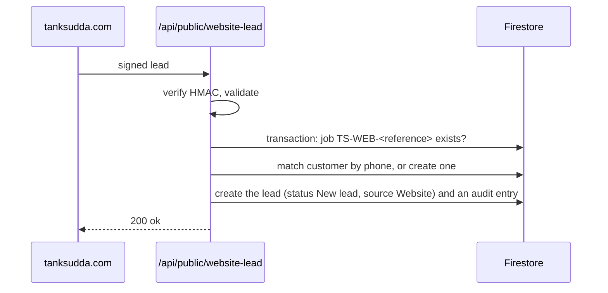

# Website leads

<!-- nav -->

<a href="../../README.md">Project README</a> · <a href="../README.md">Documentation index</a>

> How booking requests and enquiries from [tanksudda.com](https://tanksudda.com) arrive in Tank Sudda OS as leads.

## Contract

The website ([Tank-Sudda-Website-TypeScript](https://github.com/saadmaz/Tank-Sudda-Website-TypeScript)) already has a webhook delivery channel. Point it at this app:

| Website variable      | Value                                              |
| --------------------- | -------------------------------------------------- |
| `LEAD_WEBHOOK_URL`    | `https://os.tanksudda.com/api/public/website-lead` |
| `LEAD_WEBHOOK_SECRET` | The same value as `WEBSITE_WEBHOOK_SECRET` here    |

The website posts `{ "type": "lead.booking" | "lead.contact", "lead": Lead }` with the header `X-TankSudda-Signature: sha256=<HMAC-SHA256 of the raw body>`.

| Response                                 | Meaning                                        |
| ---------------------------------------- | ---------------------------------------------- |
| `200 { ok: true, id, duplicate: false }` | A new lead was created                         |
| `200 { ok: true, id, duplicate: true }`  | Already received (a retry); nothing changed    |
| `401 bad_signature`                      | Missing or wrong signature                     |
| `400 invalid`                            | The body doesn't match the `Lead` shape        |
| `503 not_configured`                     | `WEBSITE_WEBHOOK_SECRET` isn't set on this app |

## What happens

- The job id comes from the website's reference, so a retried delivery never creates a duplicate.
- The town is matched to a service location, which sets the transport fee.
- Booking requests are flagged as needing an inspection; every submitted field is kept in the lead's notes.
- A phone number already on file links the lead to that customer and marks it a repeat customer.
